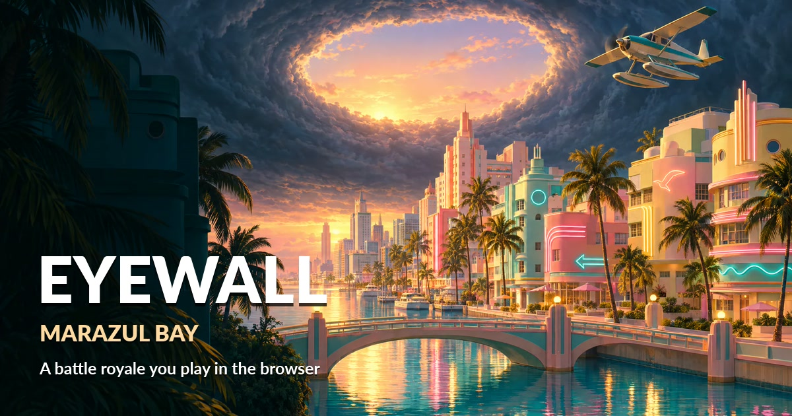
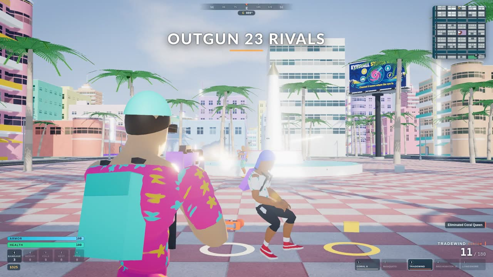
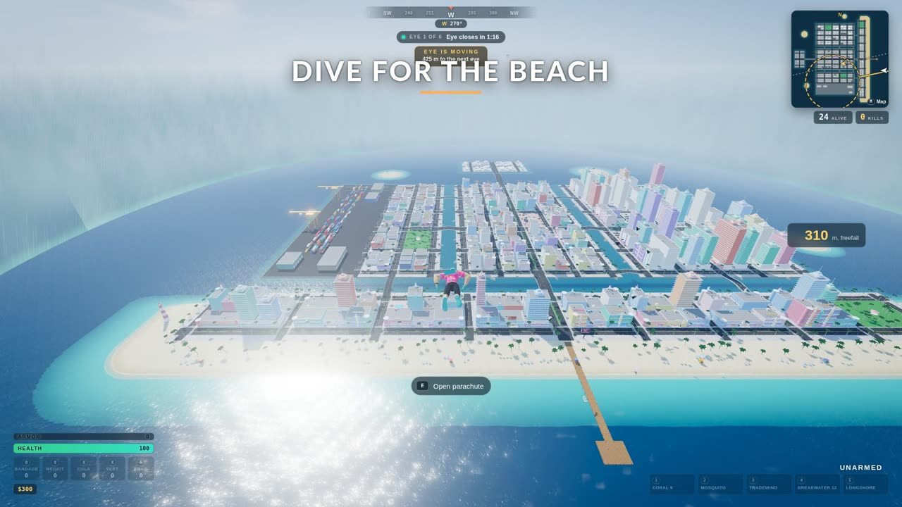
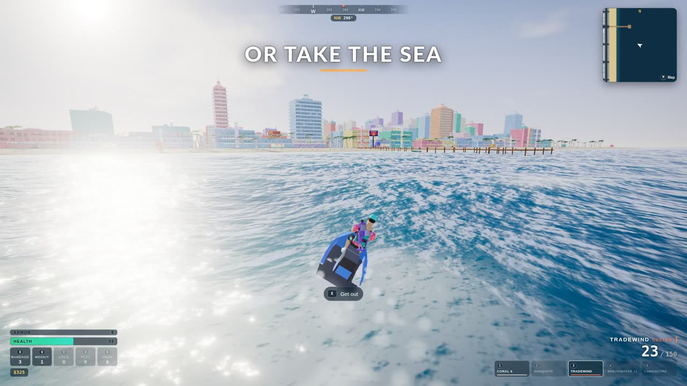
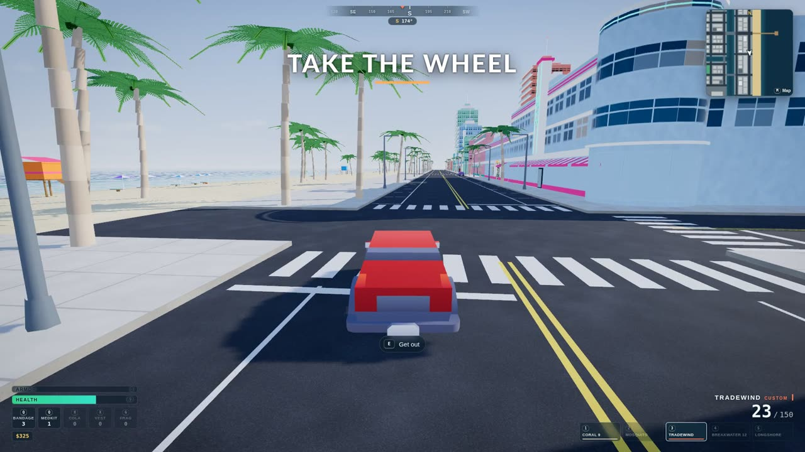

# EYEWALL: Marazul Bay

An original battle royale that runs in a browser tab. Twenty-four fighters jump from a seaplane over a pastel beach city, loot it, drive it, sail it and shoot it out while the eye of a hurricane closes on them. The last one standing wins.

**Play it now: https://anton-abyzov.github.io/fortnite-3js/** (desktop browser, keyboard and mouse)



| | |
|---|---|
|  |  |
|  |  |

## What is in it

- **The drop.** Ride the seaplane, jump when you like, steer the free fall and the canopy onto a roof, a street or a pier.
- **A whole city.** Marazul Bay is generated from one layout file: islands, canals with bridges and stairs, a beach, a marina, a port, a market, towers and a lighthouse. It is the same city on every load.
- **A body that moves.** Walk, jog, sprint, crouch, slide, jump, swim, fall and land, blended from motion clips with foot planting and leaning.
- **Five guns and a frag.** Pistol, SMG, rifle, shotgun and sniper with recoil, spread, reloads, tracers and hit reactions, plus bandages, medkits, cola and armor.
- **Cars.** Raycast suspension, engine and gears, handbrake slides, damage, and traffic that keeps its lane, takes turns at junctions and stops for whatever is in its way.
- **Boats and jet skis.** Hulls float on real buoyancy over a moving sea, plane at speed and can be beached.
- **Shops you can walk into.** Gun shops, markets and cafes with counters that sell, and a jukebox.
- **23 rivals.** Bots drop, loot, heal, fight each other, swim to the nearest stairs, run from the storm and try to win.
- **The storm.** Six phases of a closing eye, with a HUD, a minimap, a kill feed and a result screen.
- **Sound with no audio files.** Every gunshot, engine, wave and piece of music is synthesised in the browser when the game starts.

## Controls

| Key | Action |
|---|---|
| W A S D | Move, steer, drive |
| Mouse | Look, left button fires, right button aims |
| Space | Jump, open the parachute, handbrake |
| Shift | Sprint, boost a boat |
| C | Crouch, slide |
| E | Use, open, get in and out |
| 1 to 5 | Weapons |
| R | Reload |
| Q, X | Heal, armor up |
| G | Throw a frag |
| H | Horn |
| M | Map |
| Esc | Pause, settings |

## Run it yourself

Node 22 or newer.

```bash
npm install
npm run dev      # http://127.0.0.1:5183
npm run build    # production build in dist/
npm test         # Playwright, headless, on the real GPU
npm run lint
```

`EYEWALL_SWIFTSHADER=1 npm test` runs the tests on software rendering. `tools/deploy-pages.sh` builds the committed tree and publishes it to GitHub Pages. `node tools/trailer.mjs` films the trailer, with the game's own sound, while the dev server is up.

## How it is built

- [three.js](https://threejs.org) r187 for drawing, [Rapier](https://rapier.rs) 0.21 for physics, TypeScript 7 and Vite 8. There is no game engine underneath.
- Gameplay runs in a fixed 60 Hz step. Drawing runs once per frame.
- The city, the navigation grid for the bots and the loot all derive from `src/world/layout.ts`.
- Tests drive the real game with key and mouse events and read its state from `window.__eyewall`.
- 3D models are CC0 kits by Kenney and Quaternius. The billboards, murals and title art were generated for this project. Everything is listed in [CREDITS.md](CREDITS.md).

The work is tracked as a SpecWeave increment in `.specweave/increments/0001-miami-battle-royale-fable/spec.md`: the decisions, the acceptance criteria and a ledger of every finished task with its test output. `AGENTS.md` holds the rules for anyone, human or agent, who works on the code.

## Multiplayer

The game is solo against bots today. [docs/multiplayer-evaluation.md](docs/multiplayer-evaluation.md) weighs whether and how to add online play, with architecture, netcode options and hosting costs. The short answer: yes, as the second release, with a server that runs the same simulation.

## How it was made

One prompt, given to Claude Fable 5.2 inside [SpecWithCode](https://specwithcode.com), on a Linux mini PC with an integrated GPU. The agent planned the work, wrote the code, generated the art, filmed the trailer and deployed the site.

## An original game

EYEWALL: Marazul Bay is its own game: its name, map, characters, interface, sounds and music were made for this project. It shares a genre with other battle royales and nothing else. It is not affiliated with or endorsed by any other game or publisher.
