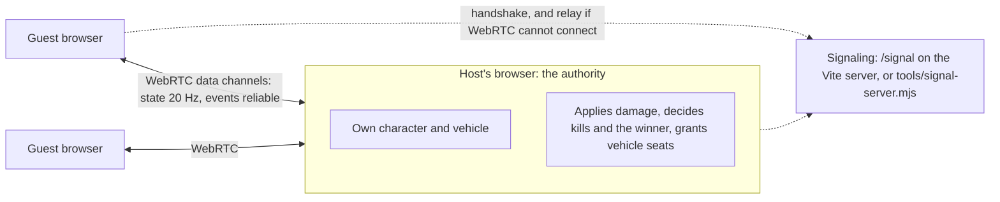

# Friends mode

A private room for the host and up to 3 friends. The host's browser runs the round; there is no game server and nothing to pay for.

## How to play

1. Start the game: `npm install && npm run dev`, then open http://127.0.0.1:5183. To let friends on your network in, start it with `npx vite --host 0.0.0.0` and share your machine's address.
2. On the title screen choose **Play with friends**, type your name and press **Create a room**.
3. Send your friends the invite link (**Copy link**) or the four-letter code. They open the link, or choose **Play with friends** and type the code, then **Join**.
4. Everyone appears in the player list. The host picks a start point and presses **Start round**.
5. Everyone starts on foot in a ring around the start point with the same kit: a rifle, a pistol, ammo, bandages and cola. Last one standing wins. **Play again** on the result card starts the next round (host) or waits for it (guests).

If your tab closes mid-round, open the invite link again within 30 seconds to get your place back with the health you had. After that you are out of the round. When the host closes the room, everyone is told.

## How it works

- Each browser simulates its own character and the vehicle it drives, exactly as in single player, and sends its state 20 times a second. The host passes everyone's state to everyone. Other players are drawn 100 ms in the past, between the two messages around that moment.
- Damage is claimed by whoever caused it and applied only by the host, which checks it (alive, in range, not more than one shot can do) and sends everyone the resulting health and armor. Kills and the end of the round come from the host.
- Getting into a vehicle seat is granted by the host, so two players cannot take the same seat.
- Guests connect to the host only (a star), over WebRTC with public STUN. If a direct channel does not open within 6 seconds, traffic goes through the signaling socket instead, so a room works on any network that can reach the signaling server.

The code is in `src/net/` (`session.ts` is the room, `transport.ts` the links, `remote.ts` the interpolation) and `src/ui/friends.ts`. The test is `tests/e2e/friends.spec.ts`: two to five headless browsers join one room and check movement, hits, the winner, vehicles, leaving and rejoining.

## Not in a friends round yet

Bots, the storm and the seaplane drop. Loot is not shared: each browser lays out the same containers but opening one does not open it for others. Vehicle damage, grenade explosions on other screens and lane traffic (held still in friends rounds) are not synced. There is no anti-cheat: the host trusts friends within the limits above.

## Playing over the internet: what is needed

GitHub Pages serves files only, so the published build has no `/signal`. Signaling needs a small always-on Node process; it keeps no game state and carries only handshakes (and relay traffic when WebRTC fails).

- Run `node tools/signal-server.mjs --port 8787` on any machine with Node that friends can reach, behind TLS for `wss://` (any reverse proxy).
- Open the game with `?signal=wss://your-host/signal`. The invite link keeps that parameter.
- Free options that need an account or a key, which Anton would have to set up: a free-tier VM or container host for `tools/signal-server.mjs`, a Cloudflare Worker port of `tools/signal-core.mjs` (Workers free plan), or a TURN service for players behind strict networks. Nothing was deployed for this increment.

Topology note: `docs/multiplayer-evaluation.md` recommends a dedicated server for public rooms. Friends mode uses the host's browser instead, by choice, because for a private room the costs that rule it out (the host could cheat, the round ends with the host's tab) are acceptable and the bill is zero.
