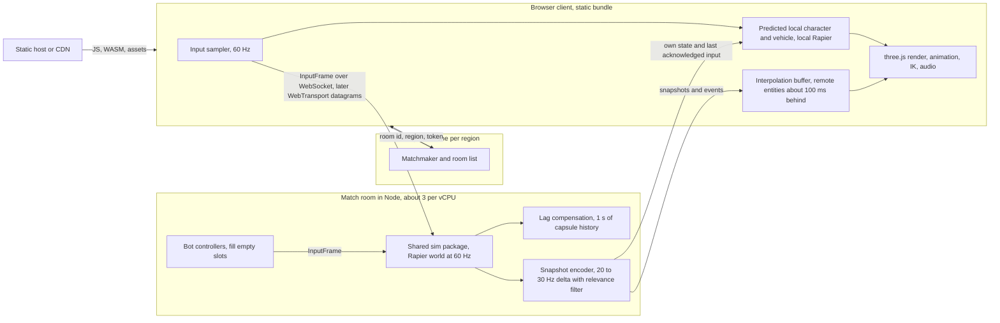

# Multiplayer evaluation: EYEWALL: Marazul Bay

Written November 11, 2026. Prices and browser support were read from the linked pages on that date. Numbers marked (estimate) are mine. Numbers marked (measured) come from the synthetic benchmark described under Hosting cost.

## Recommendation

Yes, build multiplayer, as the second release, and do one piece of groundwork now. The shape is a server-authoritative room: a Node process runs the same Rapier simulation headless at 60 Hz, clients send inputs, predict their own character and vehicle, and interpolate everything else from 20 to 30 Hz delta snapshots over WebSocket. Bots move to the server and fill empty slots, so a match can start with two humans and the game never has an empty lobby. Use Colyseus 0.18 (MIT) self-hosted on Hetzner dedicated-vCPU servers, and keep solo play fully client-side so it costs nothing to host. Order: split simulation from rendering now, then 2 to 4 player co-op rooms, then full 24-slot rooms, then anti-cheat basics, then a second region and WebTransport. My estimate is 14 to 17 weeks of one developer, and about €417 ($467) per month per 1,000 players held online around the clock on Hetzner, against about $1,350 on Fly.io and $3,330 on AWS. The main risk is engineering time, concentrated in one problem: making cars and boats feel right under latency. Deterministic lockstep and rollback are rejected.

## Is it worth it

Yes, on one condition stated at the end of this section.

A battle royale against 23 bots is a demo of a battle royale. Bots with a reaction-time aim model become readable within a few matches, and then the win stops meaning anything. Human opponents, and a friend in the passenger seat, are what bring people back.

The browser is the strongest argument. The URL is the install, so an invite link puts a friend into the same match in seconds, and the portals are built around that. The CrazyGames SDK exposes `inviteLink` and `isInstantMultiplayer`. Poki reports more than 100 million monthly players in 2026, and 54% of the players it surveyed say they often play web games with friends or family. That survey was commissioned by Poki, so read it as marketing.

| Game | Type | Players per match | Scale, as reported by the source |
|---|---|---|---|
| ZombsRoyale.io | 2D battle royale, 2018 | Up to 100, bots fill | "over 120,000,000 downloads and unique players" by 2024 (Wikipedia) |
| Shell Shockers | 3D shooter on Babylon.js, 2017 | Not published | 300,000 to 350,000 daily players at 2022 peaks, revenue "in the low seven figures annually", 80 to 90% from ads (GameDiscoverCo); over 200 million lifetime players by July 2025 (Wikipedia) |
| Krunker.io, Venge.io | 3D shooters | Not confirmed | "over 3 million monthly players" each, per a promotional VIVERSE post |
| Surviv.io | 2D battle royale, 2017 | Not confirmed | Bought by Kongregate in December 2019, shut down March 2, 2023, re-released March 20, 2026 |

Two things stand out. The proven games are simple: 2D or low-poly, with no vehicle physics. EYEWALL with server-side cars and boats would be distinctive, and it carries more netcode risk than any of them. And the usual killer of small multiplayer games, the empty lobby, is already solved here because the bots exist.

Against that: 14 to 17 weeks of work (estimate), a server bill that starts near €87 a month, cheating, and operations that never end.

The condition: multiplayer multiplies a fun game and does not rescue a dull one. If the solo build does not make people play a second match, stop there.

## Architecture

| Model | Verdict | Reason |
|---|---|---|
| Peer-to-peer mesh over WebRTC | Reject | 24 peers need 276 connections, some players cannot connect without TURN relays, and every client holds full state, so cheating is trivial |
| Relay with one player as host | Reject | The host's tab is the server. It wins every latency tie, can cheat freely, and the match dies when the tab is closed or throttled in the background |
| Authoritative dedicated server | Use | The only model where movement, damage and loot can be trusted, and the bots need a neutral place to run anyway |

**Where physics runs.** The server runs the same Rapier WASM build headless in Node at the same fixed 60 Hz step. The benchmark below ran the installed `@dimforge/rapier3d-compat` 0.21.0 under Node 24 unchanged. The client keeps its own Rapier world for prediction, camera collision and foot IK raycasts. Remote players and vehicles are kinematic proxies in it.

| Server, authoritative | Client only |
|---|---|
| Character movement, cars, boats, grenades | Rendering, skinned animation, IK, camera |
| Hit detection, damage, health, deaths | Audio, particles, wakes, tracers |
| Bots: utility AI and A* | Prediction of the local character and local vehicle |
| Zone, loot, containers, shop purchases, cash | Interpolation of remote entities |
| Match clock, traffic lane state | Gerstner waves evaluated from the synced clock, HUD |

**Bots.** A bot becomes a server-side controller that emits the same `InputFrame` a human client sends, so the simulation cannot tell them apart. Bots fill empty slots at match start and take over the slot of a player who disconnects.

**Matchmaking and rooms.** One room is one match with 24 slots. Quick play joins the open room in the nearest region. The countdown starts when two humans are present, and bots fill what is left after 30 seconds. An invite URL such as `?room=K7QF` creates or joins a private room. There are no mid-match joins. A dropped player may reconnect within 30 seconds. There is no skill matching until there is a population to split.

## Netcode options

| Transport | Delivery | Browser support | Server side | Verdict |
|---|---|---|---|---|
| WebSocket | Reliable and ordered over TCP. One lost packet stalls everything behind it | Every browser | `ws` or `uWebSockets.js`. Passes any proxy or load balancer | Ship first and keep as the permanent fallback |
| WebRTC data channel | Can be unreliable and unordered, over UDP | Every current desktop browser | ICE, DTLS and SCTP stack such as `node-datachannel`, signalling, an open UDP port range, STUN and TURN | Skip. Same benefit as WebTransport at a higher operating cost |
| WebTransport | QUIC streams plus unreliable datagrams | Chrome 97, Edge 98, Firefox 114, Safari 26.4 (released March 24, 2026). 92.37% of global usage on caniuse | HTTP/3 over UDP with a real certificate. Colyseus `@colyseus/h3-transport` wraps `@fails-components/webtransport`, and its docs say it "hasn't been battle tested" | Add in the regions phase as an upgrade for inputs and snapshots |

| Technique | Verdict | How it applies here |
|---|---|---|
| Snapshot interpolation | Use for every remote entity | 20 to 30 Hz snapshots rendered about 100 ms in the past (two snapshot intervals plus jitter, estimate). Cosmetic animation and IK run on the interpolated pose |
| Client-side prediction with server reconciliation | Use for the local character | The kinematic capsule replays unacknowledged inputs after each correction. One controller move took 0.018 ms (measured), so replaying 15 inputs costs about 0.3 ms |
| Lag compensation for hitscan | Use | The server keeps one second of capsule history, rewinds targets to the tick the shooter was seeing (capped at 250 ms, estimate) and raycasts there. Spread comes from a per-shot seed both sides share, so tracers match the server result |
| Rollback | Reject | Built for 2 to 8 players and small state. See below |
| Deterministic lockstep | Reject | Every client simulates everything, so wallhacks are free, one slow peer stalls the other 23, and one differing bit desyncs the match for good |

**Is Rapier deterministic enough for lockstep or rollback across browsers? No, not for this game.** The Rapier JavaScript docs say the WASM build is "fully cross-platform deterministic" when bodies are created in the same order and inputs come from deterministic operations, and they warn that `Math.sin` and `Math.cos` "may give different results on different platforms". The rapier.js changelog (0.15.0, March 6, 2025) says the standard packages are built without `enhanced-determinism` and sends anyone relying on it to the separate `-deterministic` flavour, which this game does not use. On one machine, 0.21.0 was bit-exact in my test: two fresh worlds matched after 1,000 steps, and a world restored from `takeSnapshot()` and stepped 500 more ticks matched the one that never stopped, vehicles included. That shows same-machine repeatability only. I could not test Chrome against Safari against Firefox.

Lockstep would also need every line of game code to be deterministic, and the Gerstner buoyancy calls `Math.sin` every tick. Rollback fails on cost first: the synthetic city world snapshot was 3.4 MB and took 4.9 ms to take and 20 ms to restore (measured), which is more than one 16.7 ms frame before any re-simulation. `takeSnapshot()` also leaves out character and vehicle controllers, so they must be rebuilt after every restore.

**Vehicles and buoyancy** are the hard part and get their own rule. A car is a dynamic body driven by a raycast vehicle controller, so it cannot be replayed cheaply the way a capsule can. Correcting it by replay means re-stepping the world. If only the server simulates it, the driver feels steering delayed by the round trip plus interpolation, about 150 to 250 ms (estimate), which is unacceptable. So the driver's client simulates its own vehicle from the inputs it sends, the server stays authoritative, and each snapshot pulls the local body toward the server state: blend small errors over about 200 ms and snap above a threshold. Other players' vehicles are interpolated kinematic proxies. The visible artefact is a collision between a predicted car and a remote one, which the server resolves a few frames late, so damage and knockdowns are decided on the server only. Boats follow the same rule and are more forgiving because water has no hard contacts. Waves cost nothing on the wire: the Gerstner function depends only on (x, z, time), so a synced match clock gives both sides the same sea. Lane-following traffic is sent as lane, offset and speed, and becomes a snapshot entity only once it is hit or driven.

## Frameworks and services

Pick Colyseus 0.18, self-hosted. It supplies rooms, matchmaking and a Node game loop and leaves the wire format alone. Use its schema sync for lobby and inventory, and custom binary messages for snapshots. Plain `ws` is the fallback if its room model gets in the way. Hathora's closure is the argument against building on a venture-funded orchestrator.

| Option | What it gives | Licence or pricing | Fit for this game |
|---|---|---|---|
| Colyseus 0.18 | Rooms, matchmaking, binary state sync, TypeScript on Node or Bun. Transports: WebSocket, `uWebSockets.js`, Bun, WebTransport | MIT, self-host free. Colyseus Cloud from $15 per month with "No CCU/DAU/MAU limits". Plan sizes are not on the pages I read | Best fit |
| Nakama | Accounts, friends, leaderboards, matchmaker, match logic in Go, TypeScript or Lua, WebSocket or rUDP | Apache-2.0, self-host free. The Heroic Cloud page shows no Nakama price (a template placeholder); support packages start at $2,000 per month | Too much backend for now. Whether its embedded script runtime can load Rapier WASM is unverified |
| PartyKit, Cloudflare Durable Objects | `partyserver`: one Durable Object per room, WebSockets, hibernation | ISC library. Workers Paid, $0.15 per million requests with incoming WebSocket messages counted 20 to 1, $12.50 per million GB-s at 128 MB per object | Good for lobby and presence. Unproven for a 60 Hz physics loop: WebSocket only, and the benchmark process grew to 330 MB resident, uncollected garbage included |
| geckos.io | WebRTC data channels between browser and Node | BSD-3-Clause, free | Skip. Needs UDP ports 1025 to 65535 forwarded, and its README steers people without that experience to WebSocket |
| Hathora | Was on-demand game server hosting | Closed. Bought by Fireworks AI. Stormgate's studio said the service winds down at the end of April 2026 | Not available |
| Rivet | Actors platform, now positioned for agents | Apache 2.0, self-host free. Cloud plans $0 to $740 per month plus nodes from $18 (1/4 vCPU) to $327 (8 vCPU) | Skip. No longer aimed at game servers, and a 1 vCPU node costs $52 |
| Photon | Realtime relay rooms. Fusion is for Unity and Unreal, Quantum for Unity | Proprietary. Free to 100 CCU, $125 per month for 500, $250 for 1,000. 3 GB of traffic per CCU, then $0.05 or $0.10 per GB | Poor. No server-side physics from three.js, and the JavaScript SDK requires an "Industries Circle" membership |
| Node or Bun plus `ws` | Full control, nothing else | MIT, free | Viable. You rebuild rooms, matchmaking and reconnection |
| SpacetimeDB 2 (newcomer) | A database that is also the server. Reducers in Rust, C#, TypeScript or C++ | BSL 1.1, converting to AGPL v3 with a linking exception. Maincloud $0, $25 and $250 per month tiers | Wrong shape for a 60 Hz Rapier world. Worth a look later for accounts and leaderboards |
| Edgegap | Container orchestration for game servers in 615+ locations | $0.00115 per vCPU-minute, $0.10 per GB egress | Option for far regions. Egress makes it about 9 times Hetzner at 1,000 CCU |

## Hosting cost

The CPU and snapshot figures come from a throwaway synthetic match run inline on November 11, 2026. It is not saved in the repo. The headless match from Phase 0 should replace it.

| Assumption | Value | Basis |
|---|---|---|
| Scene | 24 character controllers on A* paths, 20 raycast cars, 8 buoyant boats, 6 grenades, 26 raycasts per tick, 1,862 static cuboids and a 28,800-triangle terrain | Synthetic stand-in for the real map |
| CPU per tick | Mean 0.93 ms, p99 1.87 ms, 5.6% of one core | Measured: Node 24.22, Rapier 0.21.0, one AMD Ryzen 7 8745H core, 32,400 ticks |
| Budget per tick on a cloud vCPU | 3.7 ms, 22% of a vCPU | Estimate: measured × 2 for a slower shared-thread vCPU × 2 for game code missing from the benchmark (weapons, loot, bot perception, lag-compensation history, garbage collection) |
| Matches per vCPU | 3 | Estimate: 65% utilisation ceiling ÷ 22% |
| Humans per match | 16 of 24 on average, bots fill the rest | Estimate |
| Snapshot payload | 24 combatants only: 121 B at 30 Hz, 129 B at 20 Hz. All 58 entities: 378 B at 30 Hz, 401 B at 20 Hz. All 58 with a 300 m relevance radius: 105 B at 30 Hz | Measured: quantised delta against the previous snapshot, nearly every entity moving |
| Events and framing | 40 B of events per snapshot. 78 B per packet for WebSocket, TLS 1.3, TCP and IPv4 headers | Estimate |
| Downstream per player | 24 combatants only: (121 + 40 + 78) × 30 = 7.2 kB/s. All entities at 20 Hz: (401 + 40 + 78) × 20 = 10.4 kB/s. All entities at 30 Hz: (378 + 40 + 78) × 30 = 14.9 kB/s | Derived |
| Planning figure | 12 kB/s (96 kbit/s), which is 31.1 GB per player held online for a 30-day month | Estimate, between the 20 Hz and 30 Hz cases |
| Concurrency | The stated count held 24 hours a day | Worst case. A real daily curve averages lower |
| Currency | €1 = $1.12 | ECB reference rate: 1.1214 on November 10, 2026 and 1.1127 on November 11 |

| Concurrent players | Matches (÷ 16) | vCPU (÷ 3) | Egress per month (× 31.1 GB) |
|---|---|---|---|
| 100 | 7 | 3 | 3.1 TB |
| 1,000 | 63 | 21 | 31.1 TB |
| 10,000 | 625 | 209 | 311 TB |

| Host and unit prices | 100 players | 1,000 players | 10,000 players |
|---|---|---|---|
| **Hetzner Cloud**, Nuremberg, dedicated vCPU. CCX13 (2 vCPU) €43.49, CCX33 (8) €138.99, CCX43 (16) €276.49 per month before VAT. 20, 30 and 40 TB included per server, then €1.00 per TB | 2 × €43.49 = €86.98. Egress 3.1 of 40 TB included. **€87 ($97)** | 3 × €138.99 = €416.97. Egress 31.1 of 90 TB included. **€417 ($467)** | 14 × €276.49 = €3,870.86. Egress 311 of 560 TB included. **€3,871 ($4,335)** |
| **Fly.io**, `iad`. `performance-2x` (2 dedicated vCPU, 4 GB) $66.00 per month. Egress $0.02 per GB in North America and Europe | 2 × $66 = $132. 3,110 GB × $0.02 = $62. **$194** | 11 × $66 = $726. 31,100 GB × $0.02 = $622. **$1,348** | 105 × $66 = $6,930. 311,000 GB × $0.02 = $6,220. **$13,150** |
| **Cloudflare Containers**, `standard-2` (1 vCPU, 6 GiB, 12 GB disk), 3 matches each. Per instance-month of 2,592,000 s: CPU 0.66 vCPU × $0.000020 = $34.21, memory 6 GiB × $0.0000025 = $38.88, disk 12 GB × $0.00000007 = $2.18, total $75.27. Egress $0.025 per GB after 1 TB. Workers Paid $5 | 3 × $75.27 = $225.81. 2,110 GB × $0.025 = $52.75. Plan $5. **$284** | 21 × $75.27 = $1,580.67. 30,100 GB × $0.025 = $752.50. Plan $5. **$2,338** | 209 × $75.27 = $15,731.43. 310,000 GB × $0.025 = $7,750. Plan $5. **$23,486** |
| **AWS EC2**, `us-east-1`. `c8g.large` (2 vCPU, 4 GiB) $0.07976 per hour × 730 = $58.22. Egress: 100 GB free, then $0.09 per GB to 10 TB, $0.085 for the next 40 TB, $0.07 for the next 100 TB, $0.05 beyond | 2 × $58.22 = $116.45. 3,010 GB × $0.09 = $270.90. **$387** | 11 × $58.22 = $640.47. 10,240 × $0.09 + 20,760 × $0.085 = $2,686.20. **$3,327** | 105 × $58.22 = $6,113.60. 10,240 × $0.09 + 40,960 × $0.085 + 102,400 × $0.07 + 157,300 × $0.05 = $19,436.20. **$25,550** |
| **Edgegap**, on demand. $0.00115 per vCPU-minute × 60 × 730 = $50.37 per vCPU-month. Egress $0.10 per GB | 3 × $50.37 = $151.11. 3,110 GB × $0.10 = $311. **$462** | 21 × $50.37 = $1,057.77. 31,100 GB × $0.10 = $3,110. **$4,168** | 209 × $50.37 = $10,527.33. 311,000 GB × $0.10 = $31,100. **$41,627** |

Hetzner wins because traffic is bundled. On the other four hosts egress is 32 to 81% of the bill at 1,000 players, so snapshot size is the cost lever there, and a relevance filter that halves it pays for itself. Not included: one lobby node per region (about €43), monitoring, VAT, and the static bundle, which stays on a free CDN tier. Hetzner raised CCX list prices on June 15, 2026 (about +113 to +169% per a third-party report), so recheck before ordering.

Durable Objects alone would be cheaper than Fly.io on paper, about $850 per month at 1,000 players with no egress line (estimate: $4.15 of duration plus $9.33 of input messages per always-on match). Treat that as a spike to run later, not a plan.

## Phased plan

Phase 0 belongs in the current single-player increment. Everything else waits until the solo game ships. Efforts are estimates for one developer.

| Phase | Deliverable | Effort | Exit test |
|---|---|---|---|
| 0. Shared simulation | A `src/sim/` package with no three.js or DOM imports. Every actor is driven by an `InputFrame` per tick. Seeded RNG, no `Math.random` or wall clock in the simulation | 1.5 to 2 weeks | A Node script runs a 24-bot match headless to a winner, and the same seed gives the same winner |
| 1. Co-op rooms | Colyseus room running the simulation, WebSocket, binary delta snapshots, interpolation, local character prediction, lag-compensated hitscan, invite link, 2 to 4 humans plus bots | 4 to 5 weeks | Two browsers finish a match at 150 ms simulated round trip and 2% loss. Go or no-go on predicted vehicles |
| 2. Full 24-slot rooms | Quick play, bot fill and takeover, reconnect, relevance filter, vehicle and boat prediction, spectate after death | 4 to 5 weeks | 24 scripted clients complete a nine-minute match with server tick p99 under 8 ms and under 15 kB/s per client |
| 3. Anti-cheat basics | Per-tick input validation, rate limits, connection caps per address, reports, server-side statistics flags | 2 weeks | A modified client cannot speed up, fire faster, or buy without cash |
| 4. Regions | Second region, region choice by ping, WebTransport datagrams with WebSocket fallback, metrics, scaling by room count | 2 to 3 weeks | A player in each region gets under 80 ms round trip to a local room |

## Risks

| Risk | Why it matters here | Mitigation |
|---|---|---|
| Cheating | The client is readable JavaScript, so aimbots and wallhacks are easy to write | The server owns movement, damage, loot and purchases, and sends each client only nearby entities, so there is little hidden state to read |
| Latency on vehicles | Predicted dynamic bodies diverge, and collisions rubber-band | Prototype one car and one boat with two players in Phase 1 as a go or no-go gate. The fallback is server-only vehicles at lower top speed |
| Server cost | Egress dominates off Hetzner, and Hetzner's CCX list prices more than doubled in June 2026 | Keep the server a plain Node container with no host-specific API so it can move, and keep solo play off the servers |
| Browser transport support | WebTransport is missing in Safari before 26.4, and some networks block UDP | WebSocket is the baseline for everyone. WebTransport is negotiated at connect and never required |
| Engineering time | 14 to 17 weeks is an estimate, and netcode is where small projects stall | Every phase ends in something playable with an exit test. Stop after Phase 1 if co-op does not hold players |

## Sources

Browser transports

- [caniuse: WebTransport](https://caniuse.com/webtransport)
- [WebKit features for Safari 26.4](https://webkit.org/blog/17862/webkit-features-for-safari-26-4/)
- [Colyseus docs: transport](https://docs.colyseus.io/server/transport)
- [Colyseus docs: WebTransport transport](https://docs.colyseus.io/server/transport/webtransport)

Physics and netcode

- [Rapier JavaScript user guide: determinism](https://rapier.rs/docs/user_guides/javascript/determinism/)
- [rapier.js changelog](https://github.com/dimforge/rapier.js/blob/master/CHANGELOG.md)
- [Gaffer On Games: Snapshot Compression](https://gafferongames.com/post/snapshot_compression/)

Hosting prices

- [Hetzner Cloud: General Purpose plans](https://www.hetzner.com/cloud/general-purpose/)
- [Hetzner Cloud: Regular Performance plans](https://www.hetzner.com/cloud/regular-performance/)
- [Hetzner docs: traffic](https://docs.hetzner.com/robot/general/traffic/)
- [WZ-IT: Hetzner price increase June 2026](https://wz-it.com/en/blog/hetzner-price-increase-june-2026-cpx-ccx-alternatives/)
- [Fly.io docs: pricing](https://docs.fly.io/about/pricing)
- [Fly.io 2026 pricing update](https://fly.io/pricing-update/)
- [Cloudflare Containers pricing](https://developers.cloudflare.com/containers/platform/pricing/)
- [Cloudflare Durable Objects pricing](https://developers.cloudflare.com/durable-objects/platform/pricing/)
- [Cloudflare Durable Objects limits](https://developers.cloudflare.com/durable-objects/platform/limits/)
- [AWS EC2 On-Demand pricing](https://aws.amazon.com/ec2/pricing/on-demand/)
- [AWS EC2 price feed behind that page, US East, Linux](https://b0.p.awsstatic.com/pricing/2.0/meteredUnitMaps/ec2/USD/current/ec2-ondemand-without-sec-sel/US%20East%20(N.%20Virginia)/Linux/index.json)
- [AWS Price List: data transfer, us-east-1](https://pricing.us-east-1.amazonaws.com/offers/v1.0/aws/AWSDataTransfer/current/us-east-1/index.json)
- [Edgegap pricing](https://edgegap.com/resources/pricing)
- [ECB euro reference rate, US dollar](https://www.ecb.europa.eu/stats/policy_and_exchange_rates/euro_reference_exchange_rates/html/eurofxref-graph-usd.en.html)

Frameworks and services

- [Colyseus](https://colyseus.io/)
- [Colyseus pricing](https://colyseus.io/pricing)
- [Nakama on GitHub](https://github.com/heroiclabs/nakama)
- [Heroic Labs pricing](https://heroiclabs.com/pricing/)
- [PartyServer on GitHub](https://github.com/cloudflare/partykit)
- [geckos.io on GitHub](https://github.com/geckosio/geckos.io)
- [Wccftech: Stormgate loses online modes after Hathora sale](https://wccftech.com/stormgate-losing-online-modes-after-server-partner-bought-by-ai-company/amp/)
- [Rivet pricing](https://rivet.dev/pricing/)
- [Photon Fusion pricing](https://www.photonengine.com/fusion/pricing)
- [Photon SDK downloads](https://www.photonengine.com/sdks)
- [SpacetimeDB on GitHub](https://github.com/clockworklabs/SpacetimeDB)
- [SpacetimeDB pricing](https://spacetimedb.com/pricing)

Market

- [Poki: State of Web Gaming report 2026](https://poki.com/blog/state-of-web-gaming-report-2026)
- [CrazyGames SDK: game module](https://docs.crazygames.com/sdk/game/)
- [GameDiscoverCo: Shell Shockers deep dive](https://newsletter.gamediscover.co/p/deep-dive-shell-shockers-multi-million)
- [Wikipedia: Shell Shockers](https://en.wikipedia.org/wiki/Shell_Shockers)
- [Wikipedia: ZombsRoyale.io](https://en.wikipedia.org/wiki/ZombsRoyale.io)
- [Wikipedia: Surviv.io](https://en.wikipedia.org/wiki/Surviv.io)
- [VIVERSE: Fortzone Battle Royale](https://news.viverse.com/post/play-fortzone-battle-royale-viverse)
