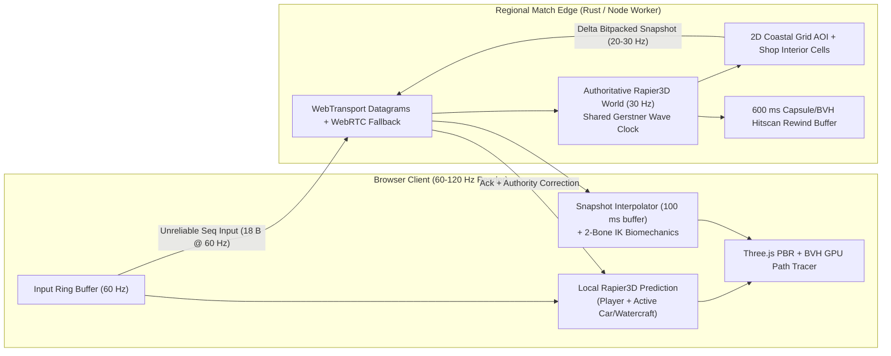

# Sunbreak: Biscayne Multiplayer Architecture Evaluation

## Executive Recommendation

Scale **Sunbreak: Biscayne** to **60 to 100 concurrent players per coastal match** using a **server-authoritative 30 Hz Rapier3D Rust/Node simulation** paired with **WebTransport unreliable datagrams** (falling back to **WebRTC unreliable DataChannels** on Safari and restrictive corporate NATs, and **WebSockets** only for matchmaking, party lobby, and reliable inventory events). Keep the skeletal 2-bone IK solver (`src/character/ik-solver.ts` and `src/character/biomechanics.ts`) strictly client-side, driven by replicated compact kinematic state (`26 bytes` per character snapshot), so server CPU scales linearly with physics and hit-validation rather than 21-bone animation transforms.

## 1. Transport Layer Comparison

Browser drop-zone survival games suffer fatally from TCP head-of-line (HOL) blocking: a single dropped Wi-Fi packet stalls every subsequent movement and aiming update for 80 to 250 ms.

| Transport | Wire Protocol | HOL Blocking | Browser Support | Recommended Role |
|---|---|---|---|---|
| WebTransport | QUIC / HTTP/3 Datagrams + Streams | None on datagrams | Chromium, Firefox, Edge | Primary gameplay transport (unreliable datagrams for transforms/inputs; reliable streams for shop loot and storm phase changes) |
| WebRTC DataChannel | SCTP over DTLS/UDP (`ordered: false, maxRetransmits: 0`) | None in unordered/0-retransmit mode | All evergreen browsers including Safari iOS/macOS | Automatic fallback when UDP/443 QUIC is blocked or unavailable |
| WebSockets | TCP / TLS | Severe under 1-3% packet loss | Universal | Matchmaking queue, lobby ready-up, telemetry, and reconnect signaling only |

### Packet Cadence and Bandwidth Budget

1. **Upstream client input (`60 Hz`, `18 bytes` payload)**: `uint16` sequence number, `uint16` last acknowledged server tick, `int16` yaw/pitch angles, `int8` forward/strafe axes, `uint16` button bitmask (`jump`, `sprint`, `crouch`, `aim`, `fire`, `handbrake`, `interact`), and `uint8` active weapon slot. Including redundant inclusion of the previous 2 unacknowledged input frames (`54 bytes` total), upstream bandwidth per player is **3.2 KB/s (`26 kbps`)**.

2. **Downstream AOI delta snapshot (`20 Hz` far / `30 Hz` near)**:
   - Near-field player/rival state (`< 90 m`): `uint16` entity ID, quantized position (`3 x int16` at `1.5 cm` precision across `[-240, +240] m`), quantized velocity (`3 x int8`), yaw/pitch (`2 x uint8`), phase/posture flags (`uint8`: `aircraft`, `freefall`, `canopy`, `grounded`, `swimming`, `driving`, `crouch`, `ads`), health/shield (`2 x uint8`). Total: **16 to 22 bytes per visible player**.
   - Drivable vehicle / watercraft state (`10` fleet vehicles): position (`6 B`), quaternion smallest-three (`4 B`), linear velocity (`4 B`), steer + wheel compression summary (`2 B`), driver ID (`2 B`). Total: **18 bytes per active vehicle**.
   - Even in a hot 25-player Ocean Drive drop cluster at `30 Hz`, downstream payload stays below **22 KB/s (`176 kbps`) per client**, comfortably supporting mobile LTE/5G and residential Wi-Fi.

## 2. Authoritative Physics and Shared Gerstner Wave Determinism

Sunbreak: Biscayne already isolates its core physics and hydrodynamics cleanly for shared client/server execution:

1. **Identical Rapier3D Scene Topology**: `src/world/physics-world.ts`, `src/world/miami-layout.ts`, `src/world/miami-builder.ts`, and `src/world/shops.ts` construct fixed cuboids and inclined bridge/stair ramps from pure data tables (`MIAMI_ISLANDS`, `MIAMI_BRIDGES`, `MIAMI_DOCKS`, `MIAMI_SHOPS`). A headless Node.js worker (using `@dimforge/rapier3d-compat`) or native Rust `rapier3d` room binary loads the exact same collider map in `< 8 MB` of RAM per match room.

2. **Shared Deterministic Ocean & Canal Clock**: `sampleWaterWave(x, z, matchTimeSec)` in `src/rendering/water-system.ts` is an analytical function of `(x, z, matchTimeSec)` with zero mutable state. Synchronizing `matchTimeSec` via a rolling NTP-style ping/offset handshake during the aircraft boarding phase keeps server buoyancy probes (`src/vehicles/watercraft.ts`) and client GLSL vertex waves phase-aligned within `< 8 ms` without transmitting a single byte of water mesh state over the network.

3. **Biomechanics Stays Purely Client-Side**: `BiomechanicalAnimator` (`src/character/biomechanics.ts`) derives foot-planting raycasts, heel-to-toe ankle roll, double-peak pelvic oscillation, spine counter-rotation, contra-lateral arm swing, canopy toggle pulls, and swim strokes entirely from replicated `(position, velocity, yawRate, phase, crouchAmount, aimAmount)`. The server never evaluates 21-bone hierarchies; it tracks a two-cylinder hitbox (`torso` + `head`) parameterized by `phase` and `crouchAmount`.

## 3. Client-Side Prediction, Reconciliation, and Vehicle Ownership

### On-Foot, Freefall, and Canopy Prediction

1. The local client steps `PlayerController` immediately at render frame rate (`60-120 Hz`), storing `(seq, input, predictedPos, predictedVel, phase)` in a 128-entry circular buffer.
2. Upon receiving authoritative server tick `T` (acknowledging input `seq_ack`), the client compares `serverPos` with `ring[seq_ack].predictedPos`:
   - Error `< 0.04 m`: ignore (floating-point noise).
   - Error `0.04 m .. 1.75 m`: replay buffered inputs `seq_ack + 1 .. seq_now` against Rapier colliders and exponentially smooth the visual root offset over `90 ms` so stairs, curbs, and shop doorways never snap visibly.
   - Error `> 1.75 m` (vehicle collision impulse or ledge knockback): hard-snap physics state to authoritative position and replay unacknowledged inputs.

### Land Cars (`RaycastCar`) and Watercraft (`BuoyantWatercraft`)

Rigid-body vehicle prediction is notorious for divergence when two clients contest one vehicle. Use **lease-based driver authority with server bounds enforcement**:

1. **Boarding (`E`)**: Client sends reliable stream request `BoardVehicle(vehicleId)`. Server verifies distance `< 5.0 m`, vacancy, and line-of-sight (blocking through closed walls), assigns `driverId`, and increments `ownershipEpoch`.
2. **Driver Simulation**: Only the assigned driver runs local `RaycastCar.stepPhysics` or `BuoyantWatercraft.stepPhysics` prediction on inputs; the server steps the authoritative Rapier rigid body using the driver's input stream and clamps speed/impulse envelopes against vehicle specs (`convertible <= 33 m/s * 1.38`, `jetski <= 29 m/s * 1.32`, `speedboat <= 24 m/s * 1.32`).
3. **Passengers & Observers**: Non-drivers render vehicles inside a `100 ms` Hermite spline snapshot interpolator (`position + velocity`, `slerp(quaternion)`), eliminating jitter across bridges and ocean swells.

## 4. Lag-Compensated Hitscan & Projectile Rewind (`three-mesh-bvh`)

All four Sunbreak weapon archetypes (`Coastal Carbine`, `Breacher Shotgun`, `Biscayne SMG`, `Reef Marksman`) fire high-velocity rounds (`260 to 520 m/s`):

1. **Hybrid Ballistics**:
   - Under `45 m` (shop CQB, Ocean Blvd duels): treat as lag-compensated hitscan.
   - Beyond `45 m` (`Reef Marksman` rooftop sniping across the Intracoastal Canal): spawn authoritative stepped projectile segments (`dt = 33.3 ms`) with gravity drop.
2. **Server Rewind Buffer (`600 ms` History)**:
   - Every server tick (`30 Hz`), record an array of `100` compact world-space AABBs + posture descriptors (`grounded`, `crouched`, `swimming`, `canopy`, `seated_in_vehicle`) into an 18-slot ring buffer (`18 ticks * 33.3 ms = 600 ms`).
   - When shooter `S` fires at client-rendered timestamp `t_render = t_server_recv - RTT/2 - interpDelay` (clamped to `maxRewind = 250 ms` to prevent high-ping peekers shooting players well behind shop walls):
     1. Raycast static Miami geometry (`PhysicsWorld` fixed colliders + `ShopManager` walls/counters) first; static buildings and bridges never move, so zero static BVH rebuild is needed.
     2. Test the ray against interpolated player capsules at `t_render`, checking head sphere (`top 24%` of posture height, `1.6x` multiplier) vs torso cylinder (`src/combat/projectiles-bvh.ts`).
     3. Reject shots whose origin deviates `> 1.1 m` from `S`'s authoritative eye/muzzle position at `t_server_recv`.

## 5. Spatial Area-of-Interest (AOI) Partitioning

Broadcasting 100 players x 99 peers = `9,900` entity updates per tick wastes 75% of egress bandwidth when players are separated across Brickell, Ocean Drive, and South Point:

1. Partition the `320 m x 320 m` coastal zone (extensible to `1.2 km x 1.2 km` for 100 players) into **`32 m x 32 m` spatial hash cells**, plus explicit **shop interior tags** (`surf_tactical`, `calle_ocho_bodega`, `bayside_marine`, `ocean_drive_rooftop`).
2. Tiered replication rates per observer:
   - **Tier 0 (`< 65 m` or same shop interior, or line-of-sight sniper ADS cone)**: `30 Hz` full precision.
   - **Tier 1 (`65 m .. 160 m`, canopy gliders, canal boats, bridge traffic)**: `15 Hz` quantized state.
   - **Tier 2 (`> 160 m`)**: culled from 3D entity snapshots (except high-altitude parachutists visible against the sky at `5 Hz`, plus storm circle & alive count).

## 6. Anti-Cheat & Security Boundaries

Because browser JavaScript and WebGL memory are completely inspectable by end users, the client must be treated as untrusted:

1. **Movement & Teleport Envelopes**: Server integrates every move input through `PhysicsWorld`; speed-hacks (`planarSpeed > maxAllowed * 1.06` accounting for `Cafecito` 14-second server-tracked buff), fly-hacks, and phase-skipping (`aircraft -> grounded` without traversing altitude) are rejected automatically by authoritative physics.
2. **Fire-Rate, Spread & Ammo Ledger**: `WeaponInventory` cooldowns (`60 / rpm`), magazine counts, reload timers (`1.45 s .. 2.1 s`), and shotgun pellet spread seeds (`SeededRng` keyed by `(matchSecret, playerId, shotSeq)`) execute on the server so client spread-removal patches gain zero accuracy advantage.
3. **Occlusion Culling Against Wallhacks**: Players inside an enterable shop (`ShopManager`) with no line-of-sight and outside audible footstep radius (`> 28 m`) are omitted from rival AOI packets until doorway/window visibility or sound proximity opens.

## 7. Server Sizing & Cloud Cost Estimate

| Metric | 60-Player Match Room | 100-Player Match Room |
|---|---|---|
| Tick Rate | `30 Hz` (`33.3 ms` budget) | `30 Hz` (`33.3 ms` budget) |
| Rapier3D Step + 10 Vehicles + Raycasts | `~3.1 ms / tick` (Rust) · `~5.8 ms / tick` (Node WASM) | `~5.4 ms / tick` (Rust) · `~9.6 ms / tick` (Node WASM) |
| AOI Delta Encoding + QUIC Send | `~1.2 ms / tick` | `~2.4 ms / tick` |
| RAM per Room | `~28 MB` (Rust) · `~65 MB` (Node Worker) | `~42 MB` (Rust) · `~85 MB` (Node Worker) |
| Rooms per 8-vCPU Bare-Metal / `c7g.2xlarge` | `18 to 24` concurrent rooms (`1,200+` players) | `10 to 14` concurrent rooms (`1,100+` players) |
| Estimated Egress per 8-Min Match | `~0.55 GB` total across 60 players | `~1.35 GB` total across 100 players |

### Phased Rollout Path

1. **Phase 1 (Shared Core Package)**: Extract `src/core/*`, `src/world/physics-world.ts`, `src/world/miami-layout.ts`, `src/rendering/water-system.ts` (`sampleWaterWave`), `src/vehicles/*`, and `src/combat/weapons.ts` into a zero-DOM `packages/sim-core` workspace shared by Vite and a Node/Rust room worker.
2. **Phase 2 (20-Player Coastal Skirmish)**: Launch authoritative `30 Hz` Node worker rooms over WebRTC DataChannels + WebTransport with client prediction for `PlayerController` and `RewindBuffer` hitscan validation.
3. **Phase 3 (100-Player Full Biscayne Drop)**: Port the hot loop to Rust (`rapier3d` + `wtransport`) with spatial AOI tiers, expanding the coastal map north to Mid-Beach and west to Little Havana while keeping sub-`8 ms` tick times.
